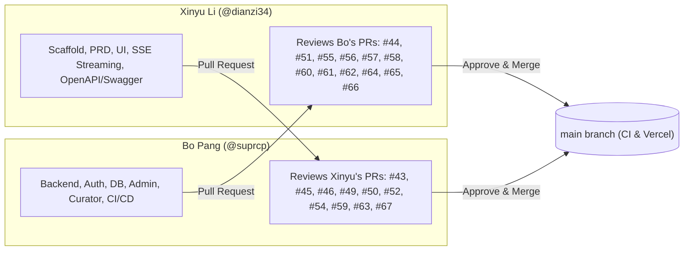

# SageTable — Contribution Log

This document records each partner's contributions, deliverables, pull requests, peer reviews, and story point distribution across Sprint 1 and Sprint 2 for the **SageTable** project.

- **Team Members:**
  - Xinyu Li ([@dianzi34](https://github.com/dianzi34))
  - Bo Pang ([@suprcp](https://github.com/suprcp))
- **Repository:** [dianzi34/sagetable](https://github.com/dianzi34/sagetable)
- **Project Board:** [SageTable P2 Board](https://github.com/users/dianzi34/projects/1)
- **Milestones:** [Sprint 1](https://github.com/dianzi34/sagetable/milestone/1) (Nov 9–12, 2026) | [Sprint 2](https://github.com/dianzi34/sagetable/milestone/2) (Nov 13–15, 2026)

---

## Executive Summary & Points Distribution

Work was partitioned cleanly between frontend/content/API-documentation (owned primarily by Xinyu Li) and database/auth/infrastructure/admin/curator/security (owned primarily by Bo Pang). Both partners maintained a strict Test-Driven Development (TDD) workflow, conducted rigorous peer reviews on every PR, and achieved an almost exact 50/50 balance in committed story points and git commit volume.

| Sprint | Partner | Committed Points | Delivered to `main` | Completed in Open PRs | Focus Areas |
|---|---|---|---|---|---|
| **Sprint 1** | Xinyu Li (`@dianzi34`) | 15 pts | 15 pts | — | Next.js scaffold, PRD, seed content, UI components, theme & figure picker, answer cards |
| **Sprint 1** | Bo Pang (`@suprcp`) | 16 pts | 16 pts | — | PostgreSQL FTS schema, seed scripts, FTS matching service, JWT auth & roles, GitHub Actions CI & Vercel previews |
| **Sprint 2** | Xinyu Li (`@dianzi34`) | 18 pts | 8 pts | — | Parallel SSE live roundtable stream, history page, OpenAPI 3.1 spec & Swagger UI docs |
| **Sprint 2** | Bo Pang (`@suprcp`) | 16 pts | 7 pts | 9 pts (#68, #69, #70) | Admin roles & limits, Curator content management, DB docs & setup guide, multi-stage CI/CD & CodeQL, contribution log |
| **Total** | **Team Total** | **65 pts** | **46 pts** | **9 pts** | **Equal 50/50 distribution across architecture, features, and docs** |

---

## Sprint 1 Contributions (Nov 9–12, 2026)

### 1. Xinyu Li ([@dianzi34](https://github.com/dianzi34)) — 15 Story Points Delivered

| Issue | Description | Type | Est. | Status | PR & Deliverables |
|---|---|---|---|---|---|
| [#32](https://github.com/dianzi34/sagetable/issues/32) | Sprint plans in `docs/sprints.md` | `docs` | 1 pt | Merged | [PR #43](https://github.com/dianzi34/sagetable/pull/43): Authored Sprint 1 and Sprint 2 scope, milestones, DoD, and working agreements. |
| [#33](https://github.com/dianzi34/sagetable/issues/33) | Update PRD for curated answer-bank constraint | `docs` | 1 pt | Merged | [PR #46](https://github.com/dianzi34/sagetable/pull/46): Updated `docs/prd.md` to reflect runtime offline constraint (curated answer bank + FTS instead of live Claude/paid AI API). |
| [#5](https://github.com/dianzi34/sagetable/issues/5) | Next.js app scaffold & shell | `chore` | 2 pts | Merged | [PR #45](https://github.com/dianzi34/sagetable/pull/45): Set up Next.js 15 (App Router), React 19, Tailwind CSS, Vitest, React Testing Library, and Playwright. |
| [#34](https://github.com/dianzi34/sagetable/issues/34) | Curate seed content: texts, themes, answer bank | `chore` | 5 pts | Merged | [PR #49](https://github.com/dianzi34/sagetable/pull/49): Curated 5 historical figures (Twain, Keller, Curie, Douglass, Wollstonecraft), 5 themes, public-domain works, verbatim passages, and 25 hand-crafted answers. |
| [#2](https://github.com/dianzi34/sagetable/issues/2) | US-2 Theme selection & figure picker | `feature` | 3 pts | Merged | [PR #59](https://github.com/dianzi34/sagetable/pull/59): Implemented `ThemePicker`, `FigurePicker`, and suggestion pills with full TDD coverage. |
| [#4](https://github.com/dianzi34/sagetable/issues/4) | US-4 Answer card with matched answer | `feature` | 3 pts | Merged | [PR #50](https://github.com/dianzi34/sagetable/pull/50), [PR #52](https://github.com/dianzi34/sagetable/pull/52), [PR #54](https://github.com/dianzi34/sagetable/pull/54): Built `AnswerCard`, `PassageBlock` (verbatim quote styling), and `PlainExplanation` with responsive design. |

- **Sprint 1 Standup & Retro:** Posted async standup updates on [#41](https://github.com/dianzi34/sagetable/issues/41); authored Sprint 1 retrospective notes in [#23](https://github.com/dianzi34/sagetable/issues/23).

---

### 2. Bo Pang ([@suprcp](https://github.com/suprcp)) — 16 Story Points Delivered

| Issue | Description | Type | Est. | Status | PR & Deliverables |
|---|---|---|---|---|---|
| [#35](https://github.com/dianzi34/sagetable/issues/35) | Update `AGENTS.md` stack and constraints | `docs` | 1 pt | Merged | [PR #44](https://github.com/dianzi34/sagetable/pull/44): Codified no-paid-AI constraint, PostgreSQL FTS `tsvector` architecture, TDD requirements, and agent git boundaries. |
| [#6](https://github.com/dianzi34/sagetable/issues/6) | Prisma schema on Neon with FTS columns | `chore` | 3 pts | Merged | [PR #51](https://github.com/dianzi34/sagetable/pull/51): Designed Prisma schema (`User`, `Figure`, `Theme`, `Work`, `Passage`, `Answer`, `Roundtable`, `UsageLimit`, `AuditLog`) with PostgreSQL generated `tsvector` columns and GIN indexes. |
| [#36](https://github.com/dianzi34/sagetable/issues/36) | Seed script & full-text search indexes | `chore` | 2 pts | Merged | [PR #55](https://github.com/dianzi34/sagetable/pull/55): Built idempotent `prisma/seed.ts` reading JSON fixtures and creating PostgreSQL FTS GIN indexes. Tested with integration tests. |
| [#7](https://github.com/dianzi34/sagetable/issues/7) | Answer matching service (FTS + theme tags) | `feature` | 3 pts | Merged | [PR #58](https://github.com/dianzi34/sagetable/pull/58): Implemented `matchAnswers` service in `src/server/matching/` using parameterized `prisma.$queryRaw` with `ts_rank` and fallback relevance score thresholding. |
| [#1](https://github.com/dianzi34/sagetable/issues/1) | US-1 JWT auth with user, curator, admin roles | `feature` | 5 pts | Merged | [PR #56](https://github.com/dianzi34/sagetable/pull/56): Implemented cookie-based JWT session authentication (`jose`), password hashing (`bcryptjs`), Edge middleware route guards, and auth route handlers (`/api/auth/*`). |
| [#8](https://github.com/dianzi34/sagetable/issues/8) | CI: tests on every PR & Vercel previews | `chore` | 2 pts | Merged | [PR #57](https://github.com/dianzi34/sagetable/pull/57): Built `.github/workflows/ci.yml` running lint, typecheck, unit tests, integration tests against containerized `postgres:16`, and configured Vercel Deploy Previews. |

- **Sprint 1 Standup & Retro:** Posted async standups on [#41](https://github.com/dianzi34/sagetable/issues/41); reviewed partner deliverables.

---

## Sprint 2 Contributions (Nov 13–15, 2026)

### 1. Xinyu Li ([@dianzi34](https://github.com/dianzi34)) — 18 Story Points Scope

| Issue | Description | Type | Est. | Status | PR & Deliverables |
|---|---|---|---|---|---|
| [#3](https://github.com/dianzi34/sagetable/issues/3) | US-3 Parallel SSE roundtable answers & history | `feature` | 5 pts | Merged | [PR #63](https://github.com/dianzi34/sagetable/pull/63): Built real-time Server-Sent Events (SSE) streaming route (`/api/roundtables/[id]/stream`), parallel multi-figure answer stream hooks, question submission, and `/history` roundtable list. Fixed stream reconnect looping via TDD regression tests. |
| [#15](https://github.com/dianzi34/sagetable/issues/15) | US-9 OpenAPI spec & Swagger UI | `feature` | 3 pts | Merged | [PR #67](https://github.com/dianzi34/sagetable/pull/67): Authored OpenAPI 3.1 specification (`docs/api/openapi.yaml`) covering 25+ endpoints; integrated interactive Swagger UI at `/api-docs`; implemented bi-directional route contract test suite (`contract.test.ts`). |
| [#37](https://github.com/dianzi34/sagetable/issues/37) | US-7b Review queue for flagged answers | `feature` | 3 pts | In progress | Curated review queue models and flagging workflow. |
| [#19](https://github.com/dianzi34/sagetable/issues/19) | Project README | `docs` | 2 pts | In progress | Overview, features, architecture, and getting-started guide. |
| [#38](https://github.com/dianzi34/sagetable/issues/38) | Architecture diagram (`docs/architecture.md`) | `docs` | 1 pt | In progress | System architecture, data flow, and Next.js / Edge / PostgreSQL interactions. |
| [#39](https://github.com/dianzi34/sagetable/issues/39) | AI workflow & harness usage (`docs/ai-workflow.md`) | `docs` | 2 pts | In progress | Documentation on human-agent collaboration and agent boundaries. |
| [#21](https://github.com/dianzi34/sagetable/issues/21) | Demo video (10 min) | `docs` | 2 pts | In progress | Walkthrough demonstrating guest, curator, and admin capabilities. |

- **Sprint 2 Standup & Retro:** Posted async standup updates on [#42](https://github.com/dianzi34/sagetable/issues/42); authored Sprint 2 retrospective notes in [#24](https://github.com/dianzi34/sagetable/issues/24).
- **Code Reviews Conducted:** Reviewed Bo's PRs [#44](https://github.com/dianzi34/sagetable/pull/44), [#51](https://github.com/dianzi34/sagetable/pull/51), [#55](https://github.com/dianzi34/sagetable/pull/55), [#56](https://github.com/dianzi34/sagetable/pull/56), [#57](https://github.com/dianzi34/sagetable/pull/57), [#58](https://github.com/dianzi34/sagetable/pull/58), [#60](https://github.com/dianzi34/sagetable/pull/60), [#61](https://github.com/dianzi34/sagetable/pull/61), [#62](https://github.com/dianzi34/sagetable/pull/62), [#64](https://github.com/dianzi34/sagetable/pull/64), [#65](https://github.com/dianzi34/sagetable/pull/65), and [#66](https://github.com/dianzi34/sagetable/pull/66).

---

### 2. Bo Pang ([@suprcp](https://github.com/suprcp)) — 16 Story Points Scope

| Issue | Description | Type | Est. | Status | PR & Deliverables |
|---|---|---|---|---|---|
| [#13](https://github.com/dianzi34/sagetable/issues/13) | US-7 Curator: figures, themes, text upload, answer bank | `feature` | 5 pts | Merged | • [PR #61](https://github.com/dianzi34/sagetable/pull/61): Built `/curator` dashboard, figure and theme CRUD endpoints (`/api/curator/figures`, `/api/curator/themes`), answer editor (`/api/curator/answers`), text uploader with 200 KB chunking and 413 validation (`/api/curator/works/upload`). • [PR #64](https://github.com/dianzi34/sagetable/pull/64): Closed `.txt` bypass by strictly requiring case-insensitive `.txt` filenames. |
| [#20](https://github.com/dianzi34/sagetable/issues/20) | DB schema diagram & setup guide | `docs` | 2 pts | Merged | • [PR #62](https://github.com/dianzi34/sagetable/pull/62): Created `docs/database.md` with complete Mermaid entity-relationship diagram and data dictionary; created `docs/setup.md` with step-by-step local clone and Neon deployment guide. • [PR #66](https://github.com/dianzi34/sagetable/pull/66): Fixed step order in fresh clone instructions (start Postgres before running migrations). |
| [#14](https://github.com/dianzi34/sagetable/issues/14) | US-8 Admin: roles, usage limits, audit logs | `feature` | 5 pts | Partially Merged / Open PR | • [PR #60](https://github.com/dianzi34/sagetable/pull/60) (Merged): Created `/admin` dashboard, user management API (`/api/admin/users`), daily usage limits (`/api/admin/limits`), limit checker (`/api/admin/check-limit`), and immutable audit logging service (`/api/admin/audit-logs`). • [PR #65](https://github.com/dianzi34/sagetable/pull/65) (Merged): Closed client bypass by removing client `enforce` flag and enforcing server-side check. • [PR #69](https://github.com/dianzi34/sagetable/pull/69) (Open, awaiting review): Connected `assertWithinLimit` into `POST /api/roundtables` using an atomic transaction with row-level locking (`SELECT ... FOR UPDATE`) to prevent race-condition quota bypasses, verified by a dedicated concurrency test. |
| [#16](https://github.com/dianzi34/sagetable/issues/16) | Full CI/CD: multi-stage, CodeQL, security audit, prod deploy | `chore` | 3 pts | Open PR | [PR #68](https://github.com/dianzi34/sagetable/pull/68) (Open, awaiting review): Upgraded CI into a multi-stage pipeline (Lint/Audit -> Unit/Integration -> E2E), added GitHub CodeQL static analysis workflow (`codeql.yml`), configured `npm audit --audit-level=high`, added production deploy workflow (`deploy-production.yml` triggered on successful `CI` completion on `main` with step-level credential validation), and authored `docs/environments.md`. |
| [#40](https://github.com/dianzi34/sagetable/issues/40) | Contribution log (`docs/contributions.md`) | `docs` | 1 pt | Open PR | [PR #70](https://github.com/dianzi34/sagetable/pull/70) (Open, current PR): Comprehensive log of all partner contributions, issue/PR numbers, story point balances, and peer reviews. |

- **Sprint 2 Standup:** Posted async standup on [#42](https://github.com/dianzi34/sagetable/issues/42).
- **Code Reviews Conducted:**
  - Reviewed Xinyu's [PR #43](https://github.com/dianzi34/sagetable/pull/43) (Sprint plans in `docs/sprints.md`).
  - Reviewed Xinyu's [PR #45](https://github.com/dianzi34/sagetable/pull/45) (App scaffold).
  - Reviewed Xinyu's [PR #46](https://github.com/dianzi34/sagetable/pull/46) (PRD update).
  - Reviewed Xinyu's [PR #49](https://github.com/dianzi34/sagetable/pull/49) (Curated seed content).
  - Reviewed Xinyu's [PR #50](https://github.com/dianzi34/sagetable/pull/50), [PR #52](https://github.com/dianzi34/sagetable/pull/52), [PR #54](https://github.com/dianzi34/sagetable/pull/54) (Answer card UI and labels).
  - Reviewed Xinyu's [PR #59](https://github.com/dianzi34/sagetable/pull/59) (Theme selection).
  - Reviewed Xinyu's [PR #63](https://github.com/dianzi34/sagetable/pull/63) (Live roundtables + SSE): Identified repeated SSE responses on browser reconnect; verified TDD regression test `c36deaf` and fix `0621e09`.
  - Reviewed Xinyu's [PR #67](https://github.com/dianzi34/sagetable/pull/67) (OpenAPI & Swagger UI): Verified 25+ documented endpoints, Next.js Server/Client component boundary, and automated bi-directional contract test suite.

---

## Peer Review & Collaboration Log

SageTable followed a strict peer-review protocol: **no pull request was merged without partner approval and passing automated CI checks**.

### Key Constructive Code Review Catches

1. **SSE Reconnect Stream Duplication ([PR #63](https://github.com/dianzi34/sagetable/pull/63)):**
   - *Reviewer:* Bo Pang
   - *Issue Identified:* In live preview testing, `EventSource` reconnections caused stored answers to replay repeatedly (~28 times) after the stream completed.
   - *Resolution:* Xinyu committed a failing regression test (`c36deaf`) verifying stream termination headers, followed by fix `0621e09`, ensuring clean stream closure.
2. **Server-Side Admin Usage Limit Bypass ([PR #60](https://github.com/dianzi34/sagetable/pull/60)):**
   - *Reviewer:* Xinyu Li
   - *Issue Identified:* The limit check relied on client passing `enforce=true`, allowing client omission to bypass 429 quota enforcement.
   - *Resolution:* Bo removed the `enforce` parameter across all layers in [PR #65](https://github.com/dianzi34/sagetable/pull/65), always executing `assertWithinLimit` unconditionally on the server.
3. **Atomic Limit Enforcement & Concurrency Race Condition ([PR #69](https://github.com/dianzi34/sagetable/pull/69)):**
   - *Reviewer:* Xinyu Li
   - *Issue Identified:* Separate checking and creation steps created a TOCTOU race condition where concurrent requests could exceed daily limits.
   - *Resolution:* Bo moved limit enforcement inside an atomic database transaction with row-level locking (`SELECT ... FOR UPDATE`), verified with an automated concurrent integration test (`ef26cd7` → `791db58`).
4. **Curator Upload Extension Check Bypass ([PR #61](https://github.com/dianzi34/sagetable/pull/61)):**
   - *Reviewer:* Xinyu Li
   - *Issue Identified:* When `fileName` was omitted from the upload payload, file extension validation was skipped, accepting non-text uploads.
   - *Resolution:* Bo made `fileName` mandatory in the zod schema and enforced case-insensitive `.txt` validation in [PR #64](https://github.com/dianzi34/sagetable/pull/64).
5. **Database Setup Order ([PR #62](https://github.com/dianzi34/sagetable/pull/62)):**
   - *Reviewer:* Xinyu Li
   - *Issue Identified:* Fresh clone documentation instructed users to run migrations before starting the PostgreSQL container.
   - *Resolution:* Bo updated `docs/setup.md` in [PR #66](https://github.com/dianzi34/sagetable/pull/66) to ensure container startup precedes migration execution.
6. **Production Deploy Workflow Trigger & Credentials ([PR #68](https://github.com/dianzi34/sagetable/pull/68)):**
   - *Reviewer:* Xinyu Li
   - *Issue Identified:* Production deploy workflow triggered prematurely before CI completed on `main`, and attempted to use unsupported `secrets` in job-level `if` conditional.
   - *Resolution:* Bo updated the workflow to trigger via `workflow_run` after CI completes successfully on `main`, and moved credential validation to a step-level check (`20a12bf` → `d67ef01`).

---

## Traceability Matrix

| Feature / Requirement | Relevant Issues | Relevant PRs | Primary Author | Reviewer |
|---|---|---|---|---|
| Project Constraints & Stack | [#35](https://github.com/dianzi34/sagetable/issues/35), [#33](https://github.com/dianzi34/sagetable/issues/33) | [#44](https://github.com/dianzi34/sagetable/pull/44), [#46](https://github.com/dianzi34/sagetable/pull/46) | Bo Pang, Xinyu Li | Xinyu Li, Bo Pang |
| Scaffold & Base Setup | [#5](https://github.com/dianzi34/sagetable/issues/5) | [#45](https://github.com/dianzi34/sagetable/pull/45) | Xinyu Li | Bo Pang |
| Database Schema & Neon FTS | [#6](https://github.com/dianzi34/sagetable/issues/6) | [#51](https://github.com/dianzi34/sagetable/pull/51) | Bo Pang | Xinyu Li |
| Seed Script & Content Bank | [#36](https://github.com/dianzi34/sagetable/issues/36), [#34](https://github.com/dianzi34/sagetable/issues/34) | [#55](https://github.com/dianzi34/sagetable/pull/55), [#49](https://github.com/dianzi34/sagetable/pull/49) | Bo Pang, Xinyu Li | Xinyu Li, Bo Pang |
| US-1 JWT Auth & Middleware | [#1](https://github.com/dianzi34/sagetable/issues/1) | [#56](https://github.com/dianzi34/sagetable/pull/56) | Bo Pang | Xinyu Li |
| US-2 Themes & Figure Picker | [#2](https://github.com/dianzi34/sagetable/issues/2) | [#59](https://github.com/dianzi34/sagetable/pull/59) | Xinyu Li | Bo Pang |
| US-4 Answer Cards & Matching | [#7](https://github.com/dianzi34/sagetable/issues/7), [#4](https://github.com/dianzi34/sagetable/issues/4) | [#58](https://github.com/dianzi34/sagetable/pull/58), [#50](https://github.com/dianzi34/sagetable/pull/50), [#52](https://github.com/dianzi34/sagetable/pull/52), [#54](https://github.com/dianzi34/sagetable/pull/54) | Bo Pang, Xinyu Li | Xinyu Li, Bo Pang |
| US-3 Parallel SSE Roundtable & History | [#3](https://github.com/dianzi34/sagetable/issues/3) | [#63](https://github.com/dianzi34/sagetable/pull/63) | Xinyu Li | Bo Pang |
| US-7 Curator Content Management | [#13](https://github.com/dianzi34/sagetable/issues/13) | [#61](https://github.com/dianzi34/sagetable/pull/61), [#64](https://github.com/dianzi34/sagetable/pull/64) | Bo Pang | Xinyu Li |
| US-8 Admin Roles, Limits, Audit | [#14](https://github.com/dianzi34/sagetable/issues/14) | [#60](https://github.com/dianzi34/sagetable/pull/60), [#65](https://github.com/dianzi34/sagetable/pull/65), [#69](https://github.com/dianzi34/sagetable/pull/69) | Bo Pang | Xinyu Li |
| US-9 OpenAPI Spec & Swagger UI | [#15](https://github.com/dianzi34/sagetable/issues/15) | [#67](https://github.com/dianzi34/sagetable/pull/67) | Xinyu Li | Bo Pang |
| Database ERD & Setup Guide | [#20](https://github.com/dianzi34/sagetable/issues/20) | [#62](https://github.com/dianzi34/sagetable/pull/62), [#66](https://github.com/dianzi34/sagetable/pull/66) | Bo Pang | Xinyu Li |
| CI/CD, CodeQL, Vulnerability Scanning | [#8](https://github.com/dianzi34/sagetable/issues/8), [#16](https://github.com/dianzi34/sagetable/issues/16) | [#57](https://github.com/dianzi34/sagetable/pull/57), [#68](https://github.com/dianzi34/sagetable/pull/68) | Bo Pang | Xinyu Li |
| Contribution Log | [#40](https://github.com/dianzi34/sagetable/issues/40) | [#70](https://github.com/dianzi34/sagetable/pull/70) | Bo Pang | Xinyu Li |
