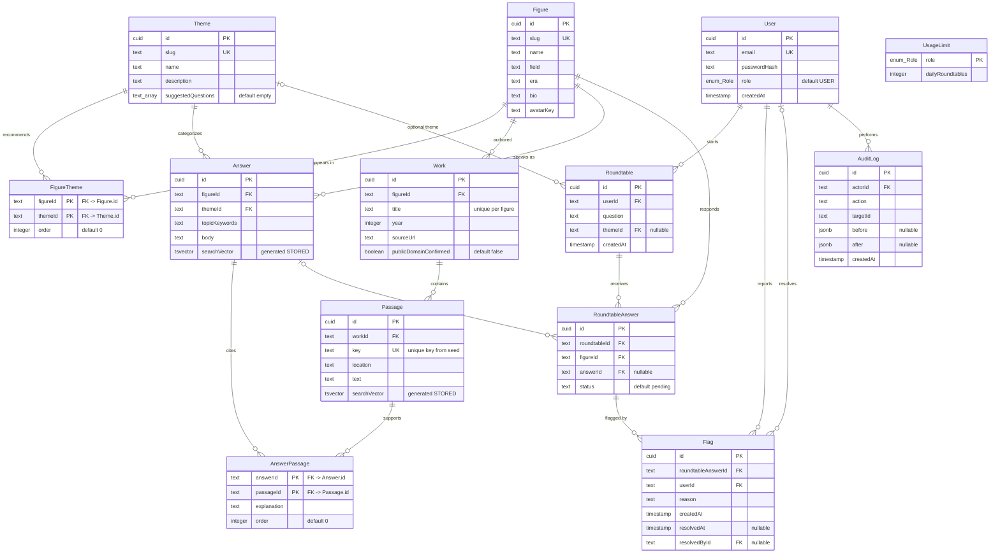

# SageTable Database Schema

SageTable uses **PostgreSQL 16** with **Prisma ORM** ([`prisma/schema.prisma`](../prisma/schema.prisma)) and SQL migrations ([`prisma/migrations/20261112000307_init/migration.sql`](../prisma/migrations/20261112000307_init/migration.sql)).

Because SageTable does not call external AI APIs, answers and public-domain primary-source passages are stored in PostgreSQL and matched using native `tsvector` full-text search columns with GIN indexes.

## Entity-Relationship Diagram



## Enums & Tables

### Enum `Role`

| Value | Intended Permissions |
| --- | --- |
| `USER` | Default role for registered users; starts roundtables and flags answers. |
| `CURATOR` | Manages figures, themes, public-domain works/passages, answer-bank entries, and flagged-answer reviews. |
| `ADMIN` | Manages user roles, per-role daily roundtable quotas (`UsageLimit`), and inspects `AuditLog`. |

### Identity & Access Control

| Table | Purpose | Key Constraints & Delete Rules |
| --- | --- | --- |
| `User` | Authenticated account credentials (`email`, `bcryptjs` `passwordHash`, `role`). | `id` PK (`cuid`); `email` `UNIQUE` (`User_email_key`); `role` defaults to `USER`. |
| `UsageLimit` | Daily roundtable quota per `Role`. | `role` PK (`Role` enum). |
| `AuditLog` | Immutable audit trail of privileged mutations (`action`, `targetId`, `before`/`after` `JSONB`). | `id` PK (`cuid`); `actorId` FK -> `User.id` (`ON DELETE CASCADE`). |

### Curated Content & Primary Sources

| Table | Purpose | Key Constraints & Delete Rules |
| --- | --- | --- |
| `Figure` | Historical figure profile (`slug`, `name`, `field`, `era`, `bio`, `avatarKey`). | `id` PK (`cuid`); `slug` `UNIQUE` (`Figure_slug_key`). |
| `Theme` | Discussion theme (`slug`, `name`, `description`, `suggestedQuestions` `TEXT[]`). | `id` PK (`cuid`); `slug` `UNIQUE` (`Theme_slug_key`); `suggestedQuestions` defaults to `'{}'`. |
| `FigureTheme` | Maps themes to ordered suggested figures. | Composite PK `(figureId, themeId)`; FKs -> `Figure.id`, `Theme.id` (`ON DELETE CASCADE`). |
| `Work` | Public-domain work metadata (`title`, `year`, `sourceUrl`, `publicDomainConfirmed`). | `id` PK (`cuid`); `UNIQUE (figureId, title)` (`Work_figureId_title_key`); `figureId` FK -> `Figure.id` (`ON DELETE CASCADE`). |
| `Passage` | Verbatim public-domain passage chunk (`location`, `text`, `searchVector`). | `id` PK (`cuid`); `key` `UNIQUE` (`Passage_key_key`); `workId` FK -> `Work.id` (`ON DELETE CASCADE`); GIN index on `searchVector`. |
| `Answer` | Curated first-person response (`topicKeywords`, `body`, `searchVector`). | `id` PK (`cuid`); FKs -> `Figure.id`, `Theme.id` (`ON DELETE CASCADE`); GIN index on `searchVector`. |
| `AnswerPassage` | Links curated answers to 1–2 verbatim passages with a plain-English `explanation` and display `order`. | Composite PK `(answerId, passageId)`; FKs -> `Answer.id`, `Passage.id` (`ON DELETE CASCADE`). |

### Roundtables & Moderation

| Table | Purpose | Key Constraints & Delete Rules |
| --- | --- | --- |
| `Roundtable` | User-submitted question, optional `Theme`, and creation timestamp. | `id` PK (`cuid`); `userId` FK -> `User.id` (`ON DELETE CASCADE`); nullable `themeId` FK -> `Theme.id` (`ON DELETE SET NULL`). |
| `RoundtableAnswer` | Per-figure slot inside a roundtable (`answerId` is null when no match passes `MATCH_THRESHOLD` or before completion). | `id` PK (`cuid`); `UNIQUE (roundtableId, figureId)` (`RoundtableAnswer_roundtableId_figureId_key`); `roundtableId` & `figureId` (`ON DELETE CASCADE`); nullable `answerId` FK -> `Answer.id` (`ON DELETE SET NULL`). |
| `Flag` | User inaccuracy report against a `RoundtableAnswer`, optionally resolved by a curator/admin (`resolvedAt`, `resolvedById`). | `id` PK (`cuid`); `roundtableAnswerId` & `userId` (`ON DELETE CASCADE`); nullable `resolvedById` FK -> `User.id` (`ON DELETE SET NULL`). |

## Indexes & Constraints Summary

| Index / Constraint | Table | Type | Target Columns |
| --- | --- | --- | --- |
| `User_email_key` | `User` | `UNIQUE B-tree` | `(email)` |
| `Figure_slug_key` | `Figure` | `UNIQUE B-tree` | `(slug)` |
| `Theme_slug_key` | `Theme` | `UNIQUE B-tree` | `(slug)` |
| `Work_figureId_title_key` | `Work` | `UNIQUE B-tree` | `(figureId, title)` |
| `Passage_key_key` | `Passage` | `UNIQUE B-tree` | `(key)` |
| `FigureTheme_pkey` | `FigureTheme` | `PRIMARY KEY` | `(figureId, themeId)` |
| `AnswerPassage_pkey` | `AnswerPassage` | `PRIMARY KEY` | `(answerId, passageId)` |
| `RoundtableAnswer_roundtableId_figureId_key` | `RoundtableAnswer` | `UNIQUE B-tree` | `(roundtableId, figureId)` |
| `UsageLimit_pkey` | `UsageLimit` | `PRIMARY KEY` | `(role)` |
| `Passage_searchVector_idx` | `Passage` | `GIN` | `(searchVector)` |
| `Answer_searchVector_idx` | `Answer` | `GIN` | `(searchVector)` |

## Full-Text Search (`tsvector` + GIN) Notes

1. **PostgreSQL Generated Columns (`STORED`)**  
   In [`prisma/schema.prisma`](../prisma/schema.prisma), search columns are declared as `Unsupported("tsvector")? @default(dbgenerated())` because Prisma's DSL cannot express weighted `tsvector` generation formulas directly. The concrete SQL definitions live in [`prisma/migrations/20261112000307_init/migration.sql`](../prisma/migrations/20261112000307_init/migration.sql):

   - **`Passage.searchVector`**:
     ```sql
     "searchVector" tsvector GENERATED ALWAYS AS (to_tsvector('english', "text")) STORED
     ```
     Indexed with `Passage_searchVector_idx` (`USING GIN ("searchVector")`).

   - **`Answer.searchVector`**:
     ```sql
     "searchVector" tsvector GENERATED ALWAYS AS (
       setweight(to_tsvector('english', "topicKeywords"), 'A') ||
       setweight(to_tsvector('english', "body"), 'B')
     ) STORED
     ```
     Indexed with `Answer_searchVector_idx` (`USING GIN ("searchVector")`).

2. **Keyword Weighting (`A` > `B`)**  
   `Answer.topicKeywords` receives PostgreSQL text-search weight `'A'`, while `Answer.body` receives weight `'B'`. When matching queries with `ts_rank("searchVector", plainto_tsquery('english', $query))` (as verified in [`src/server/db.integration.test.ts`](../src/server/db.integration.test.ts)), curated keyword hits outrank incidental occurrences in answer prose.

3. **Querying with Parameterized `$queryRaw`**  
   Prisma's typed query methods cannot filter or rank `Unsupported("tsvector")` fields. Full-text search queries live exclusively in `src/server/matching` using `prisma.$queryRaw` tagged templates (never `$queryRawUnsafe`).

4. **Migrations vs. `prisma db push`**  
   Always manage schema changes through Prisma migrations (`npm run db:migrate` locally, `npx prisma migrate deploy` in CI/production) so the custom `GENERATED ALWAYS AS ... STORED` SQL expressions and GIN indexes remain intact.

## Integration Test Reset Order

Because foreign keys enforce referential integrity across all 13 tables, [`resetTestDatabase()`](../src/server/testDb.ts) clears test data inside a single Prisma `$transaction` in child-to-parent order:

```
AuditLog -> UsageLimit -> Flag -> RoundtableAnswer -> Roundtable
-> AnswerPassage -> Answer -> Passage -> Work -> FigureTheme
-> Theme -> Figure -> User
```
